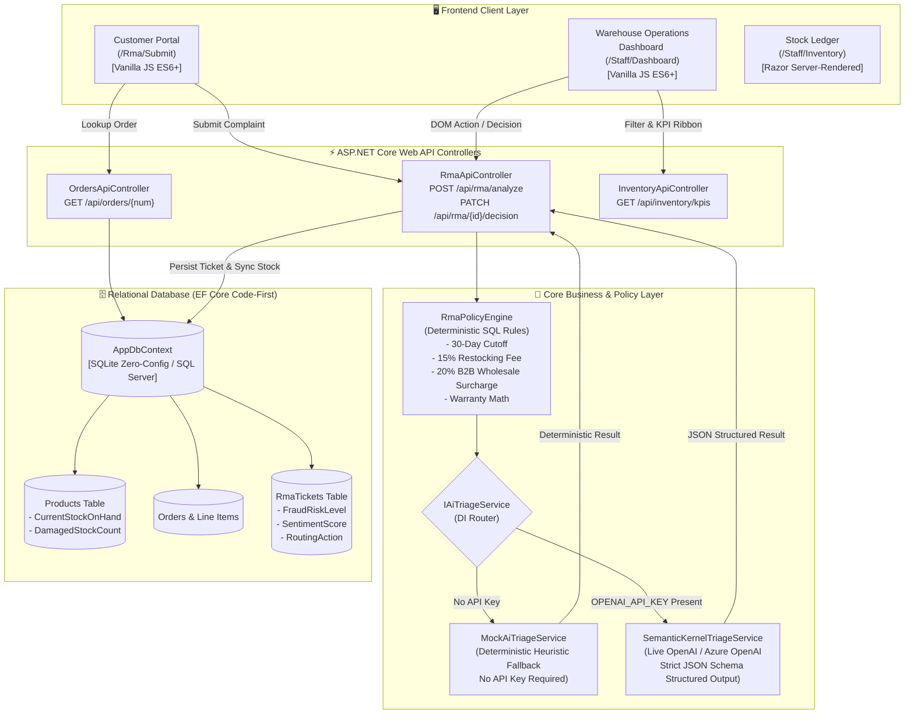

# ReturnFlow AI - Intelligent B2B/B2C RMA & Reverse Logistics Engine

[](https://dotnet.microsoft.com/)
[](https://dotnet.microsoft.com/apps/aspnet)
[](https://learn.microsoft.com/ef/core/)
[](#-dual-mode-ai-triage-engine)
[](#-testing--quality-assurance)

---

## 📌 Executive Summary & Business Context

Product sellers and multichannel brands lose significant gross margin to **Return Merchandise Authorization (RMA) friction**, fraudulent warranty claims, and inefficient reverse logistics routing. 

**ReturnFlow AI** is a production-grade enterprise engine built on **.NET 10.0 LTS**. It combines **strict deterministic SQL domain rules** (delivery date cutoffs, multi-channel restocking fees, warranty limits) with **probabilistic LLM reasoning** (unstructured complaint triage, sentiment quantification, fraud scoring, and warehouse routing) to eliminate manual returns processing overhead.

---

## 🏗️ High-Level System Architecture



---

## ⚖️ Deterministic Rules vs. Probabilistic LLM Grounding

A fundamental design flaw in naive "AI returns" apps is allowing the language model to decide financial and policy eligibility. An LLM can hallucinate that an item purchased 400 days ago is within a 30-day return policy.

**ReturnFlow AI solves this via Grounded Hybrid Architecture:**

```
  Customer Complaint (Unstructured Text)
                 │
                 ▼
  ┌────────────────────────────────────────────────────────┐
  │ 1. Relational Database Ground Truth (SQL Server/SQLite) │
  │    • Days Since Delivery: 75 days                       │
  │    • Return Window (30d): EXPIRED                      │
  │    • Hardware Warranty (365d): ACTIVE                   │
  │    • Sales Channel: B2B Wholesale                       │
  └────────────────────────┬───────────────────────────────┘
                           │
                           ▼
  ┌────────────────────────────────────────────────────────┐
  │ 2. Deterministic C# Policy Engine (RmaPolicyEngine)   │
  │    • Evaluates eligibility before calling AI           │
  │    • Computes restocking fees (15% retail, 20% B2B)    │
  └────────────────────────┬───────────────────────────────┘
                           │
                           ▼
  ┌────────────────────────────────────────────────────────┐
  │ 3. LLM Grounded Prompt Injection (System Prompt)       │
  │    • Injects database facts as immutable ground truth  │
  │    • LLM performs semantic analysis only:              │
  │      - Defect categorization (Hardware vs Abuse)       │
  │      - Sentiment score (1-10 escalation risk)          │
  │      - Fraud/abuse pattern recognition                 │
  │      - Warehouse reverse logistics routing             │
  │      - Professional customer email drafting            │
  └────────────────────────┬───────────────────────────────┘
                           │
                           ▼
  ┌────────────────────────────────────────────────────────┐
  │ 4. Strict JSON Schema Structured Output                │
  │    • Machine-readable contract (AiTriageResult)        │
  │    • Direct persistence to SQL database                │
  └────────────────────────────────────────────────────────┘
```

---

## 🤖 Dual-Mode AI Triage Engine

The application seamlessly operates in two modes via the `IAiTriageService` interface:

1. **Zero-Config Deterministic Mode (`MockAiTriageService`):**
   * Automatically activates when no `OPENAI_API_KEY` is present.
   * Reviewers, hiring managers, and CI test suites can clone the repository and run all flows immediately with **zero API costs or setup**.
   * Employs keyword classification heuristics to reliably handle all 3 demo presets:
     * **Preset 1 (Legitimate Warranty Defect):** Electrical smell / disconnects $\rightarrow$ `HardwareDefect`, `Low` fraud risk, `ApproveReplacement`, `SendToRefurbish`.
     * **Preset 2 (Buyer's Remorse):** Tactile switch sound / opened box $\rightarrow$ `BuyerRemorse`, 15% restocking fee applied, `ApproveWithRestockingFee`.
     * **Preset 3 (Suspected Abuse / Extortion):** Dropped down stairs / review blackmail $\rightarrow$ `SuspectedAbuse`, `High` fraud risk (9/10 sentiment), `HoldInQuarantine`.

2. **Live LLM Mode (`SemanticKernelTriageService`):**
   * Activates automatically when `OPENAI_API_KEY` is provided in `appsettings.json` or the environment.
   * Utilizes OpenAI / Azure OpenAI endpoints with JSON Schema mode (`response_format: { type: "json_object" }`).
   * Grounds responses in SQL facts, preventing hallucinations.
   * Features automatic fallback to deterministic heuristic mock if credits expire or network drops.

---

## 🗄️ Relational Database Schema (EF Core)

| Entity | Primary Key | Key Fields | Purpose |
|---|---|---|---|
| **`Product`** | `Id` | `Sku` (Unique Index), `Name`, `Category`, `UnitPrice` (`decimal(18,2)`), `WarrantyDays`, `CurrentStockOnHand`, `DamagedStockCount` | Inventory master catalog with stock ledger counters |
| **`Order`** | `Id` | `OrderNumber` (Unique Index), `CustomerName`, `CustomerEmail`, `OrderDate`, `DeliveredDate`, `SalesChannel` (Enum string), `TotalAmount` | Multi-channel purchase order records |
| **`OrderLineItem`** | `Id` | `OrderId` (FK), `ProductId` (FK), `QuantityPurchased`, `UnitPricePaid` | Individual items purchased per order |
| **`RmaTicket`** | `Id` | `TicketNumber` (Unique Index), `OrderId` (FK), `OrderLineItemId` (FK), `Status`, `CustomerComplaintRawText`, `CalculatedRefundAmount`, `RestockingFeeAmount`, `AiExtractedDefectCategory`, `AiSentimentScore`, `AiFraudRiskLevel`, `AiRecommendedAction`, `WarehouseRoutingAction` | Complete audit trail of customer complaints, policy calculations, and AI triage |

---

## 🚀 Quick Start Guide

### Prerequisites
* [.NET 10.0 SDK](https://dotnet.microsoft.com/download/dotnet/10.0)

### 1. Clone & Run (Zero-Config SQLite Mode)
```bash
git clone https://github.com/RuchitAgrawal/return-Policy.git
cd "return-Policy"

# Restore and run the Web project (automatically creates and seeds returnflow.db)
dotnet run --project src/ReturnFlow.Web/ReturnFlow.Web.csproj
```

Open your browser to:
* **Customer Self-Service Portal:** `http://localhost:5000/Rma/Submit` (or `https://localhost:5001/Rma/Submit`)
* **Warehouse Staff Dashboard:** `http://localhost:5000/Staff/Dashboard`
* **Live Stock Ledger:** `http://localhost:5000/Staff/Inventory`
* **Swagger API Explorer:** `http://localhost:5000/swagger`

### 2. Switching to SQL Server (Optional)
In `src/ReturnFlow.Web/appsettings.json`:
```json
{
  "Database": {
    "Provider": "SqlServer"
  },
  "ConnectionStrings": {
    "DefaultConnection": "Server=(localdb)\\mssqllocaldb;Database=ReturnFlowDb;Trusted_Connection=True;MultipleActiveResultSets=true"
  }
}
```

### 3. Enabling Live OpenAI (Optional)
Set your API key via environment variable:
```powershell
$env:OPENAI_API_KEY = "your-actual-openai-api-key"
dotnet run --project src/ReturnFlow.Web/ReturnFlow.Web.csproj
```
The navbar badge will immediately switch from `Zero-Config Mock AI` to `Live OpenAI Active`.

---

## 🧪 Testing & Quality Assurance

The test suite covers deterministic date calculations, restocking math, inventory state transitions, and AI fallback behavior.

```bash
dotnet test
```

### Test Suite Overview (17 Passing Unit Tests)
* **`RmaPolicyEngineTests`**
  * `Evaluate_Delivered29DaysAgo_IsWithinReturnWindow`
  * `Evaluate_Delivered30DaysAgo_BoundaryIsWithinReturnWindow`
  * `Evaluate_Delivered31DaysAgo_IsOutsideReturnWindow`
  * `Evaluate_OpenedUnused_WithinReturnWindow_Applies15PercentRestockingFee`
  * `Evaluate_B2BWholesale_OpenedUnused_Applies20PercentRestockingFee`
  * `Evaluate_Defective_WithinReturnWindow_ZeroRestockingFee`
  * `Evaluate_WithinWarranty_HardwareDefect_ZeroRestockingFee`
  * `Evaluate_OutsideWarrantyAndReturnWindow_Rejected`
* **`InventoryRoutingTests`**
  * `ApplyInventorySync_RestockToSellable_IncrementsCurrentStockOnHand`
  * `ApplyInventorySync_SendToRefurbish_IncrementsDamagedStockCount`
  * `ApplyInventorySync_ScrapDefect_IncrementsDamagedStockCount`
  * `ApplyInventorySync_HoldInQuarantine_DoesNotModifyCounters`
* **`AiTriageFallbackTests`**
  * `AnalyzeAsync_LegitimateWarrantyDefect_IdentifiesHardwareDefectAndApproveReplacement`
  * `AnalyzeAsync_BuyersRemorseOpened_IdentifiesRemorseAndApproveWithRestockingFee`
  * `AnalyzeAsync_SuspectedAbuse_IdentifiesAbuseAndEscalatesToQuarantine`
  * `AnalyzeAsync_SentimentScores_AlwaysWithinOneToTenRange`
  * `IsLiveMode_ReturnsFalseForMockService`

---

## 📡 REST API Surface

| Method | Endpoint | Description |
|---|---|---|
| `GET` | `/api/orders/{orderNumber}` | Fetches order and line items with computed warranty badges |
| `POST` | `/api/rma/analyze` | Evaluates complaint through policy engine and AI triage; creates ticket |
| `GET` | `/api/rma` | Lists all RMA tickets with query filters (`status`, `fraudRisk`, `channel`) |
| `GET` | `/api/rma/{id}` | Returns comprehensive detail for the slide-over inspector |
| `PATCH` | `/api/rma/{id}/decision` | Staff decision (`Approve`, `ApplyRestockingFee`, `Reject`) with inventory sync |
| `GET` | `/api/inventory` | Live inventory ledger with aggregated return rates per product |
| `GET` | `/api/inventory/kpis` | KPI summary ribbon metrics for dashboard header |

---

## 💻 Frontend Architecture (Vanilla JS ES6+)

Built without heavy SPA frameworks to showcase mastery of core web fundamentals:
* **Direct DOM Manipulation:** Dynamic line item rendering, reactive filter bars, animated badge state transitions, and responsive toast notifications.
* **Fetch API:** Asynchronous API communications with error handling and loading spinner orchestration.
* **CSS Component Design:** Dynamic sentiment meter using hue gradients, enterprise KPI ribbons, and split-pane slide-over inspector.

---

## 🎨 Editorial Design System & Advanced Capabilities

ReturnFlow AI features a design language inspired by editorial AI platforms like MiniMax:

* **Typography & Palette:** Geometric **DM Sans** body type paired with **JetBrains Mono** for financial/SKU figures. Stark monochrome canvas (`#ffffff` canvas, `#0a0a0a` deep ink) broken open by 32px corner-radius vibrant gradient showcase cards.
* **Pure Pill Architecture:** Universal pill-shaped buttons (`rounded-full`), segmented pill tabs, and pill badges across every screen.

### 5 Advanced Operational Upgrades

1. **Interactive Carrier Return Shipping Label Modal:**
   * Delhivery Express priority reverse logistics manifest modal.
   * Scalable vector Code-128 barcode representation and dedicated `@media print` layout for one-click physical label printing.
2. **Interactive Policy Sandbox & Window Simulator:**
   * Live interactive slider (1 to 400 days) allowing immediate recalculation of 30-day return cutoffs, warranty status, and estimated restocking fees in the DOM before filing.
3. **Minimalist Chart.js Operations Analytics:**
   * Compact 200px responsive charts: Donut chart displaying Defect Category Distribution and Bar chart displaying Financial Risk by Channel in INR.
4. **Drag and Drop Photo Evidence Upload Zone:**
   * Interactive file dropzone with instant thumbnail rendering, simulated damage pattern scanning, and simulated OCR serial extraction.
5. **Power-User Keyboard Shortcuts:**
   * Streamlined keyboard navigation for warehouse operators:
     * `[A]` Approve & Sync stock
     * `[R]` Reject return claim
     * `[J]` / `[K]` Cycle down/up through table rows
     * `[/]` Quick-focus search input
     * `[Esc]` Close inspector drawer or blur input

---

## 📄 License
This project is licensed under the MIT License.
